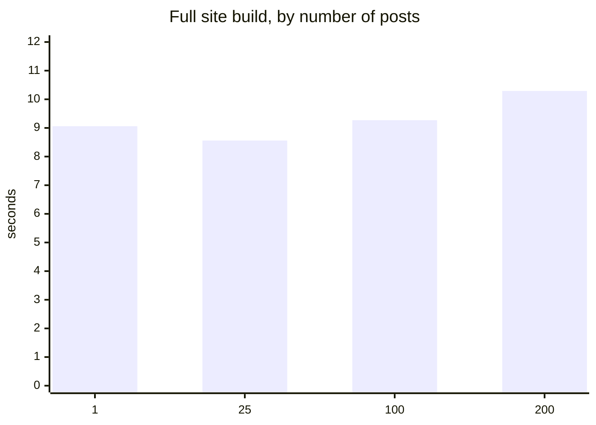
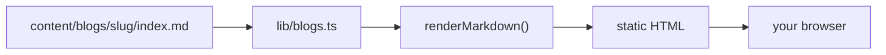
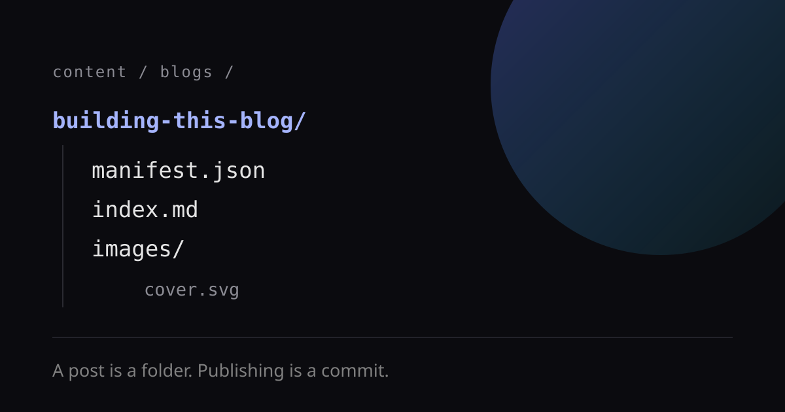

This post is a folder in the repository. Nothing else. No CMS, no database, no
API between me and the site — just markdown, a manifest, and a build.

## Why local markdown

Every post lives at `content/blogs/<slug>/`, and the folder name is the URL:

```text
content/blogs/building-this-blog/
├── manifest.json     # title, author, date, tags
├── index.md          # the body you are reading
└── images/
    └── cover.svg
```

`manifest.json` carries the metadata the page needs:

```json
{
  "title": "Building this blog",
  "author": "Suraj Pratap Singh",
  "date": "2026-10-08",
  "tags": ["nextjs", "markdown"]
}
```

## Why is there no API?

The default shape for a blog is a table of posts with an API in front of it:
insert a row, serve it over HTTP, render the response in the browser. That is
the right shape when posts are written by strangers, edited by a team, or
published by someone who must not be able to deploy the site.

Here there is one author, one repository, and every publish is already a commit.
So rather than run all of that, I outsourced it:

| A traditional blog needs | This blog has |
| ------------------------ | ------------- |
| A database               | A directory   |
| A query language         | `readdir`     |
| An ORM                   | `JSON.parse`  |
| Migrations               | Renaming a folder |
| Backups                  | `git clone`   |
| Replication              | `git push`    |
| Authentication           | It's my laptop |
| Rate limiting            | Nobody reads this |
| A health check           | `ls`          |
| An on-call rotation      | Also me, but asleep |
| 99.9% uptime             | Someone else's CDN, for free |

The API is `git push`. The database is the filesystem. The origin is a build
artifact. If the blog is down, so is the rest of my life, and nobody will notice
the difference.

This is not dogma. If a stranger ever needs to write a post, or an editor needs
to publish without deploying, the API comes back — that is precisely the problem
it solves. Right now the only person who writes posts has a terminal open.

## What it costs instead

The honest cost of local markdown is build time, and it is small enough to
measure. Here is the whole site — every page, not just the blog — built with a
growing number of posts:



Cold `next build` (Turbopack) on an Apple M4, wall-clock for the entire site.
Going from one post to two hundred moves the build by about **1.2 seconds** —
roughly 6 ms per additional post, and the low end is inside run-to-run noise.
The bars are meant to look flat. That is the result.

One caveat, because "static" is not the same as "light": a cold load of this
page still pulls about **850 KB of JavaScript**, and roughly half of it is
mermaid, which only pages with diagrams need. The HTML is 9.6 KB. The page is
not. Diagrams are the expensive part of this design, not the markdown.

## Diagrams are just code

A fenced `mermaid` block is rendered in the browser, and it redraws when the
theme changes:



## Images live next to the post

A relative path is rewritten to the served location, and a markdown title
becomes a caption:



## Tables, lists and code

| File            | Responsibility            |
| --------------- | ------------------------- |
| `manifest.json` | title, author, date, tags |
| `index.md`      | the markdown body         |
| `images/`       | co-located assets         |

- [x] Posts as plain markdown folders
- [x] Mermaid diagrams, theme aware
- [x] Images served from the post folder
- [ ] Cloudflare R2 for large binary assets

> Publishing is a commit: write the folder, push, and the static build picks it
> up on the next deploy.

```ts
export async function getPost(slug: string): Promise<BlogPost | null> {
  const body = await readOptional(indexFile(slug));
  if (body === null) return null;
  return { meta: summarize(await readManifest(slug), slug, body), body };
}
```

That is the whole publishing loop.
