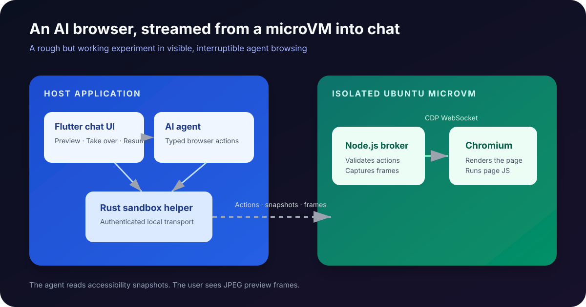
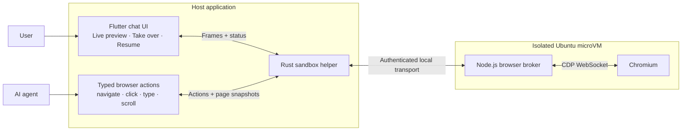

I have been trying to build something closer to Meta Muse's in-chat browser experience in one of my projects: an agent can use a real browser, I can see what it is doing in chat, and I can take over when I need to.

This is not a polished browser platform. It has rough edges, strange failure modes, websites that dislike automation, and more architectural decisions than I would confidently defend in a meeting.

But it kind of works. And that felt worth sharing.



## The shape of it

Chromium runs inside a small Ubuntu microVM. The desktop application does not talk to Chromium directly. A small Node.js broker runs inside the VM, and a Rust helper manages the boundary between the application and the VM.



The browser does its browser things inside the VM: JavaScript, page state, cookies for that session, network requests, and rendering. The host only gets a limited control channel, structured page observations, and preview frames.

That separation is doing most of the useful work here. A chat application is good at keeping history, showing controls, and rendering a compact live card. Chromium is good at navigating the actual web. The microVM gives Chromium a place to be Chromium without giving it the same access as the host application.

The goal was never to make the VM invisible. It was to make the boundary understandable:

```text
The agent asks for a typed browser action.
The host validates and relays it.
The broker turns it into an approved CDP operation.
Chromium renders the result inside the VM.
The host receives a bounded observation and optional preview frame.
```

## What starts when the agent needs a browser

The browser is not permanently running in the background. The first browser action for a chat creates a browser-profile lease, starts the broker in the guest, and connects the host to a loopback listener exposed by the helper.

The important word there is *lease*. The browser session belongs to one chat session. It can survive a completed agent reply briefly so the user can take over or send a follow-up, but it is stopped on failure, cancellation, explicit Stop, capability disablement, application shutdown, or idle expiry.

That gives a useful middle ground:

- Starting a browser is not required for every UI frame.
- A user does not lose the page immediately when the agent finishes one sentence.
- A forgotten browser does not become a permanent background VM.

At the moment, successful sessions have a five-minute idle window. That is a product choice more than a sacred systems rule. Long-lived workspaces may need a different model later.

## Why there is a broker instead of exposing Chrome directly

Chrome's DevTools endpoint is powerful. It can inspect DOM nodes, send input, inspect network state, read storage, run page JavaScript, and do a lot more than an agent should automatically receive.

So the host never connects to raw CDP. The Node.js broker is the only CDP client, and it has a fixed allowlist:

```js
const ALLOWED_CDP_METHODS = new Set([
  'Page.navigate',
  'Page.captureScreenshot',
  'Accessibility.getFullAXTree',
  'DOM.getContentQuads',
  'Input.dispatchMouseEvent',
  'Input.dispatchKeyEvent',
  'Input.insertText',
  'Target.attachToTarget',
  // ... a few lifecycle and history methods
]);
```

Notably absent:

```text
Runtime.evaluate
Runtime.callFunctionOn
Debugger.*
Cookies and storage inspection
Raw DOM extraction
```

This does not make browser automation magically safe, but it narrows the contract. The model cannot invent a random DevTools command and hope that it reaches the browser.

The host and guest both validate the action vocabulary. That duplication is intentional. If an application-side validation bug appears, the guest-side broker should still refuse the unexpected action.

## CDP is the remote control

Chromium exposes Chrome DevTools Protocol, or CDP. It is the same protocol used by DevTools and many browser automation tools. It is mostly JSON messages over a WebSocket.

For example, navigation is conceptually this:

```js
await cdp.send(
  'Page.navigate',
  { url: 'https://example.com' },
  sessionId,
);
```

I do not give the model raw CDP. The browser broker exposes a deliberately small vocabulary:

```text
navigate · snapshot · click · type · press · scroll · back · forward · wait · close
```

That is easier to validate, easier to describe to the model, and much less alarming than saying “here is a debugger connection to a browser; good luck.”

## Turning an accessibility reference into a click

The structured page snapshot is not just a summary. Interactive nodes receive stable, short-lived references such as `e1` and `e2`. When the agent requests a click, the broker resolves the reference from its latest snapshot and uses the DOM geometry to dispatch real pointer input.

Conceptually, the flow is:

```text
Agent: click ref=e3
Broker: resolve e3 in the last accessibility snapshot
Broker: obtain the element's content quad from Chromium
Broker: calculate a click point inside the quad
Broker: send Input.dispatchMouseEvent to Chromium
Broker: request a new accessibility snapshot
```

The model never says “click x=842, y=191.” That would tie it to a particular viewport and make every layout change painful. References also make the browser transcript more understandable when something goes wrong.

## The agent reads the page differently from the user

The user sees the rendered page. The agent gets a bounded accessibility snapshot.

```js
const tree = await cdp.send(
  'Accessibility.getFullAXTree',
  {},
  sessionId,
);
```

That gets reduced to something like this:

```text
heading "Sydney weather"
textbox "Search" [ref=e1]
button "Search" [ref=e2]
link "Bureau of Meteorology" [ref=e3]
```

The agent can then say “click `e3`” rather than guessing where a button is in a screenshot.

It can also request a fresh `snapshot` when the user asks what the current page says. The browser preview is for human confidence; the accessibility tree is the agent’s usable representation of the page.

The snapshot is deliberately bounded: currently 400 nodes and 12,000 characters. Without bounds, a sprawling news site or a malicious page could turn one browser action into a huge prompt injection payload or simply exhaust the model context. Page content is still treated as untrusted data, never as instructions.

That tradeoff has obvious limits. A canvas game, a chart rendered only as pixels, or a visual puzzle may not have enough useful accessibility information. The user preview can show that something exists, but the agent may not be able to understand it through this path.

## Streaming it into chat

For the first version, I chose repeated JPEG screenshots instead of attempting a full video-streaming setup.

```js
const shot = await cdp.send(
  'Page.captureScreenshot',
  {
    format: 'jpeg',
    quality: 55,
    captureBeyondViewport: false,
    fromSurface: false,
  },
  sessionId,
  2000,
);
```

The frame reaches Flutter as bytes and is rendered directly:

```dart
Image.memory(
  frameBytes,
  fit: BoxFit.contain,
  gaplessPlayback: true,
)
```

While the browser is active, the broker captures more frequently. When idle, it slows down. Frames are bounded in size and disposable under backpressure; a stale screenshot is less useful than an action result arriving on time.

This is closer to a responsive flipbook than a video stream. It is good enough for navigation, clicking, and forms. It is not pretending to be a remote desktop product.

The current parameters are intentionally conservative:

| Concern | Current limit | Why |
| --- | ---: | --- |
| Viewport | 1280 × 800 | Predictable browser geometry and bounded screenshots |
| JPEG quality | 55 | Enough to identify UI and page state without huge payloads |
| Maximum frame | 512 KiB | Avoid a single frame dominating memory or transport |
| Active interval | 250 ms | Feels live during an action without chasing video rates |
| Idle interval | 800 ms | Keeps context visible while reducing VM work |
| Screenshot deadline | 2 seconds | A stuck capture should not kill a completed navigation |
| Navigation deadline | 30 seconds | Long enough for normal pages, bounded for failed ones |

The Rust helper has two transport lanes. Results and browser status are control messages and must be delivered. Preview frames use a small bounded channel and may be dropped if the user interface is slow.

That distinction matters more than it sounds. Imagine a user drags the app window to a slow monitor or the UI is busy decoding frames. In that situation, a delayed click result is much worse than a skipped screenshot. The browser card should show the newest state it can, not faithfully replay stale frames.

Here is the Flutter side of the rendering path:

```dart
Image.memory(
  frameBytes,
  fit: BoxFit.contain,
  gaplessPlayback: true,
)
```

`gaplessPlayback` keeps the previous frame visible until the next one is decoded. It is a small detail, but it stops the preview from flashing blank between captures.

## What happens when a screenshot gets stuck

Screenshots are observation, not the browser action itself. A page can successfully navigate while Chromium is slow to answer a screenshot request.

The broker therefore treats capture as best effort. It permits only one in-flight capture and gives that CDP request a short deadline. If it fails, the capture slot is released and a later frame can be attempted. Navigation results and accessibility snapshots are not discarded just because a preview frame missed its moment.

This was one of those small implementation details that changed how usable the feature felt. A browser should not disappear merely because the camera failed to take a photo of it.

## The awkward but important part: user takeover

The user can press **Take over** and use the same browser session. Pointer input, keyboard input, dragging, and scrolling then go to Chromium rather than the surrounding chat window.

When takeover is active:

- The agent cannot navigate, click, type, or scroll.
- The user controls the existing page and retains its page state.
- The agent can still ask for a read-only snapshot to answer a question about what is currently open.
- Resume hands control back to the agent.

The raw CDP endpoint never leaves the VM. The host-side transport uses a per-session secret, and the broker validates the small action vocabulary again inside the guest.

There are actually three separate rules here:

1. The user can directly send typed browser input only after takeover.
2. Agent actions are refused while takeover is active.
3. A read-only `snapshot` remains allowed, so the agent can answer questions about the page without stealing control back.

That last rule is important. If a user scrolls to a section and asks, “What does this say?”, the agent should not have to resume control just to read the accessible representation of the page.

The preview also has to win scroll gestures over the surrounding chat. Otherwise, trying to scroll the browser simply scrolls away from the browser. Wheel signals and trackpad pan gestures inside the preview are claimed by the browser widget; if the agent owns the session, the first user scroll triggers takeover before the scroll command is forwarded.

## The transport boundary

The helper binds a TCP listener only on host loopback. Each browser lease gets a random 32-byte secret. A client must present that secret before the helper forwards messages to the guest broker.

That is not intended as a network perimeter for an adversarial machine. It is a local session boundary that prevents another local process from casually attaching to an active browser bridge just because it knows a port number.

The raw Chromium DevTools listener stays on guest loopback. The desktop app can reach the helper transport, but it never receives Chromium's WebSocket endpoint.

The guest also runs Chromium as an unprivileged user. Network rules allow the public web that the browser needs while denying loopback, private-network, and cloud metadata destinations. The browser should not accidentally become a path from a webpage to a local service or a cloud credential endpoint.

## How the agent should choose browser versus HTTP

The browser is expensive compared with a small HTTP request. It needs a VM, a Chromium process, rendering, and screenshots. For something like a public JSON endpoint, it is overkill.

The runtime guidance now encourages this order:

1. Use a dedicated search or data tool when one exists.
2. Use a bounded HTTP/API request through the sandbox for straightforward public data.
3. Use the browser for JavaScript-dependent, interactive, or explicitly browser-based tasks.

This is guidance, not a deterministic planner. Models will still occasionally choose the scenic route. The useful part is that the sandbox tool description spells out literal argv semantics, bounded curl requests, and the difference between a successful command exit code and a successful data retrieval.

For example, this is a valid short Python invocation:

```json
{
  "argv": [
    "python3",
    "-c",
    "import urllib.request; print(urllib.request.urlopen('https://example.com', timeout=20).status)"
  ]
}
```

This is *not* valid, because `python3` does not interpret shell heredoc syntax:

```text
python3 - <<'PY'
```

That needs an explicit shell, or preferably a short `python3 -c` program.

## What this does not solve yet

Quite a lot.

Some websites block raw HTTP requests. Some block automated browsers. Accessibility trees are incomplete on canvas-heavy pages. Screenshots are not a substitute for every kind of rendering or interaction. The agent can still pick an inefficient source unless the tool descriptions and system instructions guide it well.

There are also places where this design is deliberately not trying to compete with a full remote-browser product:

- There is no full-motion video stream.
- There is no browser persistence across application restarts.
- Browser downloads are not yet a durable artifact system.
- Authentication flows need a much more explicit product and credential model.
- One user browser session does not imply a general multi-agent browser-sharing system.

There are also product decisions still hiding behind engineering questions: how long should browser sessions persist, what should happen on application restart, how should downloads work, and how much of the browser state should be durable?

But the basic architecture has held up better than I expected:

1. Put the browser in an isolated microVM.
2. Use CDP for a narrow typed control interface.
3. Give the agent accessibility snapshots instead of screenshots.
4. Send preview frames to the user separately.
5. Let the user interrupt and take over the same session.

It is a weird little experiment. It is definitely not immaculate system design. But seeing an agent browse in a real isolated browser, while still being able to intervene, has made the whole thing feel much more tangible.
